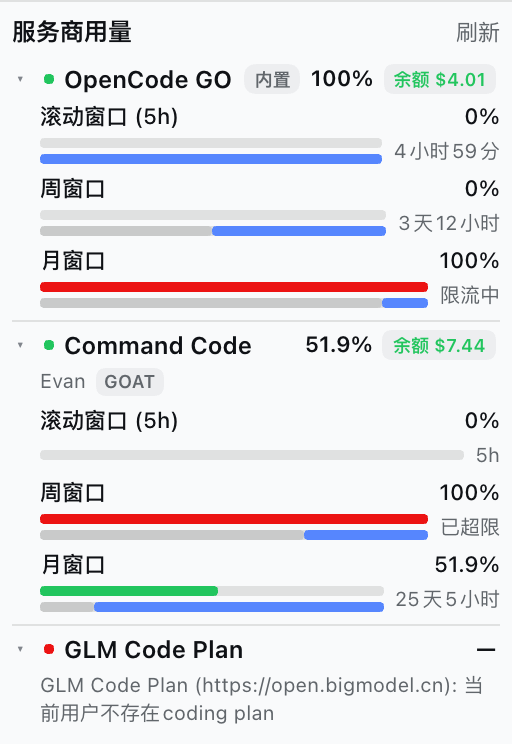

# dsh-multi-provider-usage

A [DSH](https://github.com/deepseek-ai/deepseek-harness) plugin that shows the
quotas of **OpenCode GO**, **Command Code** and **GLM Code Plan** in one sidebar
widget. It is modelled on
[`@astervolans/dsh-opencode-go-usage`](https://github.com/Astervolans/dsh-opencode-go-usage)
— same dual-half package, same-origin proxy, same sidebar slot, same Plugins
panel settings page — extended from one provider to three.

> The package name is `dsh-multi-provider-usage` because the unscoped
> `dsh-provider-usage` name is already taken on npm by a different plugin. The
> HTTP routes (`/provider-usage/*`) and chat command (`/provider-usage`) stay
> short and stable.



## Features


- **Three providers, one column.** All enabled providers are stacked vertically;
  each header carries a health dot, the provider's primary percentage and its
  top-up balance. Click a provider header to collapse/expand that provider's
  plan windows, quota bars and time bars; the collapse state is remembered
  locally, so any subset can stay folded.
- **OpenCode GO** — 5-hour, weekly and monthly windows (the API calls the 5-hour field `rolling`). Prefers the live
  `dsh-opencode-go` plugin's active account through its `opencodeGoUsage`
  host service, then falls back to the official `GET /v1/usage` endpoint.
- **Command Code** — monthly credit pool, 5-hour window and weekly window from
  the official billing/usage endpoints (`/alpha/billing/*`,
  `/alpha/usage/summary`).
- **GLM Code Plan, international and China** — 5-hour token window, weekly
  token window and monthly MCP tool limit, read from the international Z.ai
  host (`api.z.ai`) or the China BigModel host (`open.bigmodel.cn`) at
  `/api/monitor/usage/quota/limit`. `auto` probes both, the GLM card badges the
  version that answered (**International** / **China**), and the plugin
  settings can pin one version (or a custom endpoint). When neither version
  answers, the failure names each version's result instead of only the last
  probe.
- **Top-up balances** — OpenCode GO shows the OpenCode Zen prepaid balance and
  Command Code shows its purchased + free "Extra Credits" balance, both as a
  badge next to the account/plan and in the `/provider-usage` text. The OpenCode
  console token is auto-discovered from `OPENCODE_CONSOLE_TOKEN`, the OpenCode
  CLI auth file, or its local `opencode.db`; the token never leaves the host.
  When that token is missing, the balance slot becomes a clickable "Set up" chip
  that opens the plugin settings, where the OpenCode GO card renders a
  step-by-step setup guide, instead of silently showing nothing. Command
  Code's tooltip breaks its amount into purchased + free credits; a credits
  response without either pool renders a muted **No top-up** badge.
- **Auto-update** — on boot and every configured interval the host checks the
  npm registry, the npmmirror mirror and the GitHub release feed together and
  trusts the newest version any of them reports. A local `link:`/`file:` checkout
  is fast-forwarded when it is on `main`, clean, and a strict fast-forward. An
  npm / market / tarball copy updates itself: the release tarball is downloaded
  from the first source that serves it (registry → mirror → GitHub, in turn) and
  each packaged file (`lib/`, `package.json`, `cordis.patch.yml`, `docs/`) is
  written to a temp file and renamed over the target, so pnpm's hardlinked store
  is never edited in place. Either way the running Host keeps the old module
  graph, so the widget/settings show "updated — restart DSH". The plugin never
  restarts DSH by itself.
- **Balance-change animation** — the widget polls on its normal interval; when
  a provider's balance differs from the previous poll, the number counts from
  the old value to the refreshed one while a red/green delta chip (for example
  `-0.1`) floats up and fades away. There is no popup and no turn-event
  tracking, so the animation may appear up to one poll interval later.
- **Low-balance tone** — a balance at or below 5 renders amber and at or below 1
  renders red (thresholds are in the currency unit and apply to USD and CNY
  plans alike), in both the sidebar and the settings page's live-usage sections.
- **Click-to-retry failures** — an error line in the widget is itself clickable
  (and keyboard-activatable) and forces one fresh upstream read.
- **Network blips never wipe the card** — a refresh that fails only on the wire
  (`fetch failed`, a timeout, HTTP `5xx`/`429`) answers with the last successful
  read (`servedStale: true`) instead of an error, so the widget keeps its
  numbers while the host retries in the background. Actionable failures — a
  missing or rejected key, a vendor `{ success: false }` — still render their
  error card and invalidate the remembered read.
- **Same-origin proxy** — the browser only talks to `/provider-usage/usage` and
  `/provider-usage/settings`; API keys stay in the host process.
- **Failure isolation** — one broken provider never hides the other two. The
  route answers `200` while any provider succeeds and `502` only when all
  enabled providers fail. Partial endpoint failures that need attention keep
  the provider's numbers but turn its health dot amber and name the failed calls
  in the tooltip; transient ones are suppressed (see above).
- **Settings shortcut** — the widget header's **Settings** button opens this
  bundle's page in the sidebar **Plugins** panel, directly on the configuration
  page below.
- **Bundle settings page** — sidebar **Plugins** panel → this bundle's card:
  enable/disable each provider, edit credential refs and endpoints, choose the
  GLM region, and see non-network detection status. Save applies immediately.
  Each provider card embeds a **live usage** section — quota windows with
  percentages, time-to-reset and the top-up balance, from the same canonical
  snapshot the widget renders. While the page is open it follows the widget:
  a 30-second poll (when the tab is visible) plus an "Updated HH:MM" stamp,
  a **Refresh usage** control forces a re-read, and every save re-reads with
  `refresh=1`, so a changed credential ref shows its own numbers immediately.
  The GLM card also carries the **referral link** (Z.ai "Invite Friends, Get
  Credits") as a clickable, copyable row. The URL is a bundle constant: it never
  goes through the settings route and a settings save cannot overwrite it.
- **`/provider-usage` chat command** — prints every enabled provider's numbers
  as text.
- **Time bars** — under each quota bar, gray is time already elapsed and blue is
  time remaining, matching the reference widget's geometry. Each window also
  counts down to its reset on the right; an exhausted window keeps that
  countdown and gains a small **exceeded**/**rate-limited** chip right after the
  percentage, whose hover title also carries the absolute reset time.
- **`x-opencode-session` fix** — injects the real per-conversation harness
  session id into OpenCode GO chat requests at runtime, without patching DSH.
- **Chinese and English UI** through the DSH locale service.

## Install

From npm:

```bash
dsh plugin --profile desktop add dsh-multi-provider-usage
```

or, for the web profile:

```bash
dsh plugin --profile web add dsh-multi-provider-usage
```

From a checkout (for development):

```bash
dsh plugin --profile desktop add /path/to/dsh-provider-usage
```

The package declares `dsh.bundle.patch`, so the CLI reconciles it into the
profile's bundle layer stack automatically. The widget and client bundle are
part of the profile's client-modules graph, so **restart DSH once** after
installing (a running host does not rebuild its `window.__DSH_BOOT__` manifest
for a newly linked package).

For a local `link:` dependency pnpm prints a peer-dependency warning
(`@deepseek-ai/schemastery`, `@deepseek-ai/dsh`). That is expected: the linked
checkout resolves schemastery from its own `node_modules` in development; a
normal npm install resolves the peers from the DSH runtime.

## Credentials

All values are resolved through the DSH credentials domain (the process
environment, `$DSH_HOME/.credentials.yaml` and `.env` layers). They are never
returned by the settings route and never reach the browser.

| Provider | Default ref | Resolution order | Fallback source |
|---|---|---|---|
| OpenCode GO | `OPENCODE_GO_API_KEY` | `opencodeGoApiKeyEnv`, the `dsh-opencode-go` active-account ref (only when that entry is enabled), `OPENCODE_GO_API_KEY`, `OPENCODE_API_KEY` | `GET {baseUrl}/v1/usage` |
| Command Code | `COMMANDCODE_API_KEY` | `commandCodeApiKeyEnv`, `COMMANDCODE_API_KEY`, then the CLI auth file | `~/.commandcode/auth.json` (`apiKey`) |
| GLM Code Plan | `ZAI_API_KEY` | `glmApiKeyEnv`, `ZAI_CODING_CN_API_KEY`, `ZAI_API_KEY`, `ZHIPU_API_KEY`, `GLM_API_KEY`, `BIGMODEL_API_KEY` | — |

Set a ref in **Plugins → dsh-multi-provider-usage → settings** (or in the
auto-generated **Settings → Plugins → Plugin configuration** form). A ref is a
name such as `OPENCODE_GO_API_KEY`; the secret itself lives in DSH's credential
store.

### OpenCode console balance

The GO quota API does not include the account's prepaid balance. That comes from
`GET https://opencode.ai/console/api/billing/status`, which needs the OpenCode
**console** OAuth token (the GO API key returns 403 there). The host resolves it
in this order:

1. `opencodeConsoleApiKeyEnv` (`OPENCODE_CONSOLE_TOKEN` by default), resolved
   through DSH credentials;
2. the `credential` table of `~/.local/share/opencode/opencode.db` (read via
   `node:sqlite` when available; this is where current OpenCode releases keep
   the OAuth grant and rotate it);
3. `~/.local/share/opencode/auth.json` (`$XDG_DATA_HOME/opencode/auth.json` when
   set), provider `opencode` — the legacy location kept by older releases.

The database is preferred deliberately: OpenCode migrated its grant there but
often leaves the old `auth.json` behind, and that stale token returns 401. Every
usable OAuth candidate is tried in turn (at most four), so one expired store
cannot hide the live one. Channel builds (`opencode-beta.db`, `opencode-dev.db`,
…) and `$OPENCODE_DB` are discovered too. The billing host comes from the grant's
`metadata.server` (so a self-hosted console works), falling back to the public
origin; `opencodeConsoleBaseUrl` overrides it.

An OpenCode **API-key** login (`oc_sk_…`, the service-account method) carries no
console session and is never sent to the billing endpoint. Such a login, a
missing token, or an expired/revoked grant renders a clickable **Set up** chip
(instead of a mute dash) that opens this bundle's page in the Plugins panel and
names the fix: run `opencode auth login` and choose the **OpenCode Console
account**, or store a console token as `OPENCODE_CONSOLE_TOKEN`.

When the balance is not configured (or the console login is fixable), the
OpenCode GO card in the plugin settings renders a step-by-step **setup guide**
in place of the static hint. The lead-in names the state-specific fix (nothing
configured, an API-key login, or an expired sign-in). Step ① shows the
`opencode auth login` CLI command with a **Copy command** button; step ② offers
a **Re-check** button that re-reads the sign-in state and forces one upstream
usage read, so a fresh login shows the balance without restarting DSH (unsaved
form edits are never discarded by the re-check). The `/provider-usage` command
gives the same state-specific guidance as text for all three fixable states.

The optional `opencodeConsoleAuthFile` overrides the auth file (and its
directory is used to locate `opencode.db`), `opencodeConsoleOrgId` supplies the
`x-org-id` header, and `opencodeConsoleEnabled: false` turns the whole balance
read off. Balance failures never hide the GO quota: the provider stays `ok` with
`balance: null` and a `meta.balanceError` (plus `meta.balanceSetup` when the
user can fix it). Any other balance failure renders a muted **Balance —** badge
whose tooltip carries the error. A balance call that only failed on the wire
(`fetch failed`, a timeout, HTTP `5xx`/`429`) is not shown at all: it sets
`meta.balanceTransient` and the host keeps the last known balance, so an
auxiliary blip never blanks the slot or prints an error next to the quota.

### Command Code balance

Command Code's quota and balance share one API key and one billing family, so
they cannot diverge the way OpenCode's do: a missing key (`COMMANDCODE_API_KEY`
or `~/.commandcode/auth.json`) fails the whole provider with an explicit
`no API key` message rather than blanking only the balance. Two narrower gaps
are reported instead of hidden:

- when `/alpha/billing/credits` fails, that request carries every window, so the
  provider errors as well unless a previous successful read can stand in (see
  the stale fallback below); its message now includes the underlying interface
  and status instead of only "no usable quota windows", and `meta.balanceError`
  lets the header show a muted **Balance —** badge carrying the cause;
- when the credits response succeeds but carries neither `purchasedCredits` nor
  `freeCredits`, `balance` stays `null` with `meta.balanceMissing: true` and the
  header shows a muted **No top-up** badge (a real `0` still renders `$0.00`).

**Interface failures and billing period (since 0.8.7)**: Command Code reports
rate-limit/permission failures as HTTP 200 with a `{ success: false }` envelope;
those are now treated as errors and the envelope's reason reaches the message
(previously the response was parsed as data and only
`no usable quota windows` survived). When `/alpha/billing/subscriptions` fails,
the billing period comes from the summary's own `periodStart` / `periodBasis`,
and only period-scoped data feeds the monthly window.

**Silent stale fallback (since 0.8.7)**: a refresh that fails only on the wire —
`fetch failed`, a timeout, HTTP `5xx` or `429` — no longer replaces a provider
with an error card. When the host already holds a successful read for the same
account, it answers with that read (`servedStale: true`) and retries on the next
refresh, so the sidebar keeps its last known numbers instead of
`Command Code: Command Code /alpha/whoami: fetch failed; …`. The rule is
provider-wide, not Command Code-only. A transient *partial* failure is left out
of `meta.errors` as well, so the health dot and the tooltip stay quiet. Genuine
failures are never hidden: a missing key, a `401`/`403`, a vendor
`{ success: false }` envelope, or any provider with no successful read yet still
renders its error card (and a real failure also invalidates the remembered
read). The classification follows each vendor's own status code — a rejected
OpenCode GO or GLM key is never mistaken for a blip even though those reads
re-wrap the original error — and it applies to the auxiliary OpenCode console
balance read too, where a wire failure keeps the previous balance instead of
showing **Balance —**.

**Defensive GLM parsing (since 0.8.7)**: `percentage` accepts numeric strings
(common in the China deployment); a `TIME_LIMIT` without `percentage` derives it
from `currentValue / usage`; duplicate limits of the same type are suffixed with
`-2` but keep the base window's label, hint and time-bar length (instead of
becoming an "Other window").

### OpenCode GO integration and fallback

When `opencodeGoSource` is `opencode-go` (the default), the host probes:

1. a live loader entry named `opencode-go` / `dsh-opencode-go`;
2. that entry is not disabled;
3. `ctx.get("opencodeGoUsage")` exposes `read()`;
4. `read()` returns valid `rolling` / `weekly` / `monthly` data;
5. the active account is read from that entry's `apiKeyEnv` + `accounts[]`.

If any step fails, the host reads the built-in endpoint and reports a `fallback`
object with one of: `not-installed`, `entry-disabled`, `service-unavailable`,
`read-failed`, `invalid-response`. The widget shows a **Built-in** badge with the
reason and message in its tooltip. `opencodeGoSource: "builtin"` pins the HTTP
path and never touches the other plugin.

**No subscription (since 0.8.8)**: a `401`/`403` from `/v1/usage` whose body is
OpenCode's `EntitlementError` (for example `OpenCode Go subscription required.`)
is classified as `no-subscription`: the key itself was accepted, but its account
has no OpenCode GO subscription. The widget and the settings page show a
localized "check the subscription or disable the provider" line instead of the
gateway's raw JSON, and the unrelated
`dsh-opencode-go: not-installed` fallback note is no longer appended to it (the
fallback still travels in `fallback` / `meta` for diagnostics). The state is not
transient, so stale numbers never hide it.

## Plan windows

| Provider | Windows | Window length |
|---|---|---|
| OpenCode GO | `rolling`, `weekly`, `monthly` | 5 h, 7 d, ~30 d |
| Command Code | `five-hour`, `weekly`, `monthly` | 5 h, 7 d, real billing period |
| GLM Code Plan | `five-hour`, `weekly`, `mcp` | 5 h, 7 d, monthly |

Percentages are **used** percentages and are clamped to `[0, 100]` for display.
Command Code's monthly bar tracks the **plan credit pool only**:
`summary.totalMonthlyCredits / plan total` (falling back to
`planUsed + monthlyCredits` when the plan total is unknown).
`summary.totalCost` also includes purchased and free credit spend
(`totalCost = totalMonthlyCredits + totalPurchasedCredits + totalFreeCredits`),
so it is no longer part of the plan bar — top-up credits only show up in
`meta.monthly` (`used`, `purchased`, `free`, `extra`) and the top-up balance
(`balance.extra`), and `meta.monthly.planUsed` carries the plan-scoped usage.
The 5-hour/weekly bars use `windowLimits.fiveHour` / `weekly` (`used`, `cap`,
`resetAt`, `exceeded`).

**Tiny usage (since 0.8.6)**: right after a 5-hour/weekly window resets, usage is
often below 0.05%, which is under one pixel of bar width — the green fill
disappeared entirely, making the card look like it had a single (blue time) bar
or like usage was zero. Now:

- a non-zero percentage that rounds to zero renders as `<0.1%` instead of `0%`;
- any non-zero usage keeps at least a `2px` fill, so only a real `0%` is an empty bar;
- the usage track keeps a 1px inset ring so it still reads as a bar on the light sidebar.

Command Code's card therefore always shows two bars per row (green usage + blue
time) for the 5-hour, weekly and monthly windows; a just-reset window only has a
very thin green part, rather than a missing bar.

**Token usage on a window row (since 0.8.2)**: a window may carry `tokensUsed`,
the vendor's absolute token count for that window, and the widget renders it as
`Token: <number>` right after the window label, with a compact unit (亿/万 with
a Chinese locale, B/M/K otherwise; full grouped digits below the smallest unit).
Only Command Code provides one today — its billing-period `summary.totalTokens` rides on the `monthly`
window (falling back to `totalTokensIn + totalTokensOut` when the vendor omits
the combined field). No vendor reports tokens for the 5-hour or weekly windows
(Command Code's `windowLimits.used`/`cap` count credits, not tokens), so those
rows show no token count.

**Billing context (since 0.8.3)**: the monthly token count's tooltip carries
the billing-period in/out split (`meta.totals.tokensIn` / `tokensOut`) and the
request totals with success rate (`meta.totals.requests` / `successRate`); the
projected exhaustion date (`meta.projection.runsOutInDays`, Command Code)
renders right after the token count in the monthly row's label. **MCP tool calls (since 0.8.3)**: GLM's monthly `TIME_LIMIT`
counts ride on the `mcp` window as `used`/`cap` and render as "123 / 1,000"
after its label. **Recharge link (since 0.8.3)**: a low OpenCode prepaid
balance that the console marks purchasable links straight to
[opencode.ai/console](https://opencode.ai/console) from the badge.

A GLM account without a Coding Plan answers HTTP 200 with
`{ "success": false, "msg": ... }`; the adapter surfaces that message and the
widget shows the provider in an error state.

## Configuration

The loader reads the exported `Config` schema; every field is `.volatile()`, so
the settings page and the auto-generated form hot-apply.

| Field | Default | Meaning |
|---|---|---|
| `opencodeGoEnabled` | `true` | Show OpenCode GO |
| `opencodeGoSource` | `"opencode-go"` | `opencode-go` or `builtin` |
| `opencodeGoApiKeyEnv` | `"OPENCODE_GO_API_KEY"` | Credential ref |
| `opencodeGoBaseUrl` | `"https://opencode.ai/zen/go"` | Gateway base |
| `opencodeConsoleEnabled` | `true` | Read the Zen prepaid balance |
| `opencodeConsoleApiKeyEnv` | `"OPENCODE_CONSOLE_TOKEN"` | Console token ref |
| `opencodeConsoleOrgId` | `""` | Optional `x-org-id` |
| `opencodeConsoleAuthFile` | `""` | Optional auth.json path; empty auto-discovers |
| `opencodeConsoleDbFile` | `""` | Optional opencode.db path; empty derives it |
| `opencodeConsoleBaseUrl` | `"https://opencode.ai"` | Console origin |
| `commandCodeEnabled` | `true` | Show Command Code |
| `commandCodeApiKeyEnv` | `"COMMANDCODE_API_KEY"` | Credential ref |
| `commandCodeBaseUrl` | `"https://api.commandcode.ai"` | API base |
| `commandCodeAuthFile` | `""` | Empty = `~/.commandcode/auth.json` |
| `glmEnabled` | `true` | Show GLM Code Plan |
| `glmApiKeyEnv` | `"ZAI_API_KEY"` | Credential ref |
| `glmBaseUrl` | `""` | Optional base override |
| `glmRegion` | `"auto"` | `auto`, `zai`, `bigmodel`, `custom` |
| `cacheMs` | `30000` | Per-provider host cache TTL |
| `updateCheck` | `true` | npm update check (24 h) |
| `autoUpdate` | `true` | Check npm, npmmirror and GitHub together; fast-forward a clean checkout, otherwise replace an installed package from the first source that serves the tarball |
| `autoUpdateCheckHours` | `6` | Hours between auto-update checks (1–168) |
| `injectSessionHeader` | `true` | OpenCode GO session-header fix |
| `providerOrder` | all three ids | Provider display order in the widget; drag the cards in the plugin settings to reorder |

`glmRegion: "custom"` requires `glmBaseUrl`; `auto` probes
`https://api.z.ai` first and then `https://open.bigmodel.cn`, and the widget
badges the version that answered.

## HTTP API

### `GET /provider-usage/usage`

`?refresh=1` (or `?force=1`) bypasses the host cache.

A **200** with `providers: []` and `enabled: []` means every provider is
disabled (a configuration state — the widget shows its localized hint); a
**502** means providers exist but every one of them failed, and the body still
carries each provider's error.

```json
{
  "ok": true,
  "enabled": ["opencode-go", "command-code", "glm"],
  "providerOrder": ["opencode-go", "command-code", "glm"],
  "providers": [
    {
      "id": "opencode-go",
      "name": "OpenCode GO",
      "short": "GO",
      "status": "ok",
      "account": { "ref": "OPENCODE_GO_API_KEY", "id": null, "name": "" },
      "plan": null,
      "source": "builtin",
      "requested": "opencode-go",
      "fallback": {
        "from": "opencode-go",
        "reason": "not-installed",
        "message": "dsh-opencode-go is not installed, or its profile entry is inactive"
      },
      "balance": {
        "amount": 5.01495352,
        "currency": "USD",
        "labelKey": "balance.zen",
        "source": "opencode-db",
        "details": { "billingMode": "prepaid", "mode": "pay-as-you-go" }
      },
      "windows": [
        {
          "key": "rolling",
          "labelKey": "window.five-hour",
          "hintKey": "window.five-hour.hint",
          "percent": 0,
          "status": "ok",
          "resetsAt": "2026-11-05T13:50:46.363Z",
          "windowMs": 18000000
        }
      ],
      "meta": {}
    }
  ],
  "update": { "current": "0.1.0", "available": false, "latest": null },
  "sessionHeader": { "active": true, "count": 0, "diag": {} }
}
```

Failed providers have `"status": "error"`, `code`, `error` and `windows: []`;
their siblings are still returned. A body with `providers: []` means no provider
is enabled. `meta.balanceError` carries a tolerated balance failure (the
provider still answers `ok`); `meta.balanceSetup` (`no-credential`, `api-key` or
`expired`) marks a failure the user can fix by signing in again;
`meta.balanceMissing` marks a Command Code credits response without
purchased/free pools. `meta.errors` lists partial Command Code endpoint
failures worth showing: the numbers stay, the health dot turns amber, and the
tooltip names the failed calls (transient ones — timeout, `5xx`, `429` — are
not listed; see the stale fallback above). Error cards keep the plan they
already resolved.

**Caching and refresh semantics (since 0.8.1)**: the host keeps a TTL cache per
provider (`cacheMs`, default 30 s). Once a provider's entry has expired, the
next request **answers instantly with the last-known value** (top-level and
per-provider `servedStale: true`) while a background read refreshes upstream —
a slow provider (up to its 15 s fetch timeout) can no longer stall the sidebar
widget or the `/provider-usage` command; the widget follows up automatically a
few seconds later. `?refresh=1` still blocks on a fresh read (manual refresh
and post-save behavior are unchanged); an account/source switch never serves
the previous account's data. A read that fails only on the wire answers with
the last good value instead of an error (see the stale fallback above), and a
failed background refresh never replaces a good document with an error one. A
settings save drops the cached reads (so the next poll re-reads with the saved
values) but keeps each provider's last good read as that fallback.
Responses carry an `ETag`; a request with `If-None-Match` gets `304` with no
body while the document is unchanged. The sidebar widget stretches its poll gap
while nothing changes (from 30 s up to 2 min).

### `GET /provider-usage/settings`

Returns the settings descriptor (`namespace`, `revision`, `value`, `base`,
`user`) plus a non-network `detection` report:

```json
{
  "ok": true,
  "namespace": "dsh-multi-provider-usage",
  "revision": 0,
  "value": { "opencodeGoEnabled": true },
  "detection": {
    "providerOrder": ["opencode-go", "command-code", "glm"],
    "enabled": ["opencode-go", "command-code", "glm"],
    "providers": {
      "opencode-go": { "configured": true, "entryFound": false, "fallback": { "...": "..." } },
      "command-code": { "configured": true, "source": "auth-file" },
      "glm": { "configured": true, "region": "auto" }
    }
  }
}
```

`503` means the host has no settings service or the entry has no volatile
fields; the settings page explains how to fix it.

### `POST /provider-usage/settings`

Only the fields in the table above are accepted; anything else is ignored.
`expectedRevision` gets `409` on a concurrent change.

```json
{
  "patch": { "commandCodeEnabled": false, "providerOrder": ["glm", "opencode-go", "command-code"] },
  "expectedRevision": 0
}
```

Cross-origin writes are refused with `403`. The usage route is read-only.

## How it is put together

| Half | File | Role |
|---|---|---|
| host (Node) | `lib/index.js` | Config schema, routes, command, settings/detection, cache, session fix |
| host adapters | `lib/providers.js` | Canonical window shape and the three vendor adapters |
| console balance | `lib/opencode-console.js` | OpenCode console token discovery + billing status |
| session fix | `lib/opencode-session.js` | `globalThis.fetch` wrapper + `llm/stream` ALS context |
| browser | `lib/client.js` | Hand-authored `window.__ModuleLoader__.load({ id, factory })` bundle: widget, settings page, locale dictionaries |
| bundle patch | `cordis.patch.yml` | Inserts the profile entry |

The browser bundle is composed by DSH's official client-modules scan from
`dsh.client` + `exports["./client"]`; it registers into
`sidebar.footer.action` and `plugins.bundle.config`, exactly like the reference
plugin.

The session fix wraps `globalThis.fetch` once and only adds
`x-opencode-session` when the request URL starts with the gateway base carried
by the current `llm/stream` call. The base comes from
`llm-pi-ai.providers.<route>.baseURL`, falling back to `opencodeGoBaseUrl`.

## Compatibility

- DSH `0.1.7` and above, with no upper bound (future DSH lines included); verified on `0.2.1-rc.5`.
- `@deepseek-ai/schemastery` `^3.18.4` (volatile fields / settings page).
- Node.js ≥ 18 (global `fetch`, `AbortSignal.timeout`).
- `dsh-opencode-go` is optional; its absence is a normal fallback.
- Command Code's CLI auth file is optional if `COMMANDCODE_API_KEY` is set.
- A DSH runtime that does not expose `plugins.bundle.config` loses only the
  settings page; the sidebar widget and `/provider-usage` keep working. Set the
  config fields in the profile patch or the auto-generated form instead.

## Development

```bash
npm install
npm test
```

The tests are hermetic: a fake `globalThis.fetch` and a stub Cordis context, no
network and no real keys. They cover the schema, all three adapters, OpenCode
GO service integration/fallback, aggregation and error isolation, caching,
forced refresh, the transient-failure stale fallback and balance carry-over,
settings conflicts/whitelisting, the client bundle contract, top-up balance
discovery (credential and local auth.json) and failure isolation, and the
session-header injection. 164 tests, all offline.

## License

MIT.
