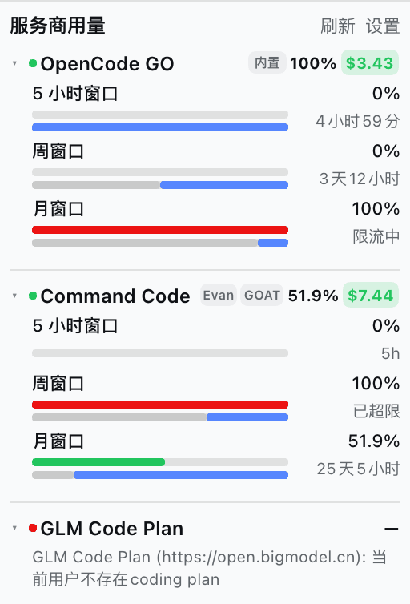

# dsh-multi-provider-usage

[DSH](https://github.com/deepseek-ai/deepseek-harness)（DeepSeek Harness）插件：
在同一个侧边栏组件里查看 **OpenCode GO**、**Command Code** 和 **GLM Code Plan**
三个服务商的套餐用量。它以
[`@astervolans/dsh-opencode-go-usage`](https://github.com/Astervolans/dsh-opencode-go-usage)
为蓝本——同样的双端包结构、同源代理、侧边栏插槽和 Plugins 面板设置页——从单一
服务商扩展到三个。

> npm 上 `dsh-provider-usage` 已被另一个插件占用，所以包名使用
> `dsh-multi-provider-usage`。HTTP 路由（`/provider-usage/*`）和聊天命令
> （`/provider-usage`）仍保持简短。

## 功能




- **一个组件，一列显示三个服务商。** 所有启用的服务商纵向排列；每家标题带健康
  状态点、主窗口百分比和充值余额。点击某一家标题即可折叠/展开该家的套餐窗口、
  额度条和时间条；折叠状态本地保存，可长期只展开需要看的几家。
- **OpenCode GO** — 5 小时窗口、周窗口、月窗口（API 中 5 小时字段名为 `rolling`）。优先读取
  `dsh-opencode-go` 插件当前账号的 `opencodeGoUsage` 宿主服务，失败时回退到官方
  `GET /v1/usage`。
- **Command Code** — 月度额度池、5 小时窗口、周窗口，数据来自官方
  `/alpha/billing/*` 与 `/alpha/usage/summary`。
- **GLM Code Plan** — 5 小时 Token 窗口、周 Token 窗口、月度 MCP 工具额度，数据
  来自 Z.ai / BigModel 的 `/api/monitor/usage/quota/limit`。
- **订阅外充值余额** — OpenCode GO 显示 OpenCode Zen 预付费余额，Command Code 显示
  购买额度 + 免费额度的 “Extra Credits” 余额；两者都显示在账号/套餐旁，并出现在
  `/provider-usage` 文本中。OpenCode 控制台令牌依次从 `OPENCODE_CONSOLE_TOKEN`、
  OpenCode CLI 的 auth.json 或本机 `opencode.db` 自动发现，令牌不会离开宿主进程。
- **自动更新** — 宿主启动后以及按配置的间隔检查 GitHub Release。只有满足
  「在 main 分支、工作区干净、可严格 fast-forward」的本地 `link:` checkout 才会
  自动 `git pull`；运行中的宿主仍持有旧模块，所以组件/设置页显示“已更新，重启
  DSH”。npm/市场安装的副本不会被插件自行改写，只提示新版本并指向插件市场。
  插件不会自行重启 DSH。
- **余额变化动画** — 组件按正常轮询周期刷新；某个服务商的余额相比上一次轮询
  发生变化时，数字会从旧值滚动到新值，同时一个红色/绿色差值（例如 `-0.1`）
  向上飘走并淡出。没有弹窗，也不依赖对话轮次事件；动画最多可能晚一个轮询周期。
- **同源代理** — 浏览器只访问 `/provider-usage/usage` 和
  `/provider-usage/settings`，API Key 始终留在宿主进程。
- **故障隔离** — 一个服务商失败不会影响另外两个；只要还有服务商成功，路由就返回
  `200`，全部失败才返回 `502`。
- **设置快捷入口** — 组件标题栏的「设置」按钮直接打开侧边栏「插件」中的本插件
  页面，并定位到下面的配置页。
- **插件设置页** — 侧边栏「插件」→ 本插件卡片：启用/禁用服务商、编辑凭据引用和
  接口地址、选择 GLM 区域，并查看无网络请求的检测状态。保存后立即生效。
- **`/provider-usage` 聊天命令** — 在对话中打印所有启用服务商的用量文本。
- **时间条** — 额度条下方，灰色是窗口已流逝时间，蓝色是剩余时间，几何尺寸与参考
  组件一致。
- **`x-opencode-session` 修复** — 运行时为 OpenCode GO 聊天请求注入真实的会话 id，
  不修改 DSH 安装文件。
- **中英文 UI** — 通过 DSH locale 服务。

## 安装

从本地 checkout 安装：

```bash
dsh plugin --profile desktop add /path/to/dsh-provider-usage
```

或安装到 web profile：

```bash
dsh plugin --profile web add /path/to/dsh-provider-usage
```

包内声明了 `dsh.bundle.patch`，CLI 会自动把它合并进 profile 的 bundle 层。
客户端 bundle 属于 profile 的 client-modules 启动图，因此**安装后重启一次 DSH**；
运行中的宿主不会为新链接的包重建 `window.__DSH_BOOT__` 清单。

使用本地 `link:` 依赖时 pnpm 会提示 `@deepseek-ai/schemastery` /
`@deepseek-ai/dsh` 的 peer 依赖警告。这是预期现象：开发时 checkout 从自己的
`node_modules` 解析 schemastery；正式 npm 安装时 peer 由 DSH 运行时提供。

## 凭据

所有凭据都通过 DSH 凭据域解析（进程环境变量、`$DSH_HOME/.credentials.yaml`、
`.env` 层）。设置路由不会返回值，浏览器也永远拿不到。

| 服务商 | 默认引用 | 解析顺序 | 回退来源 |
|---|---|---|---|
| OpenCode GO | `OPENCODE_GO_API_KEY` | `opencodeGoApiKeyEnv` → `dsh-opencode-go` 当前账号引用（仅当该条目启用）→ `OPENCODE_GO_API_KEY` → `OPENCODE_API_KEY` | `GET {baseUrl}/v1/usage` |
| Command Code | `COMMANDCODE_API_KEY` | `commandCodeApiKeyEnv` → `COMMANDCODE_API_KEY` → CLI 登录文件 | `~/.commandcode/auth.json` 中的 `apiKey` |
| GLM Code Plan | `ZAI_API_KEY` | `glmApiKeyEnv` → `ZAI_CODING_CN_API_KEY` → `ZAI_API_KEY` → `ZHIPU_API_KEY` → `GLM_API_KEY` → `BIGMODEL_API_KEY` | — |

在「插件 → dsh-multi-provider-usage → 设置」或自动生成的「设置 → 插件 →
插件配置」里填写引用名（例如 `OPENCODE_GO_API_KEY`），真正的密钥保存在 DSH
凭据库中。

### OpenCode 控制台余额

GO 额度接口不包含账户预付费余额。余额来自
`GET https://opencode.ai/console/api/billing/status`，它需要 OpenCode **控制台**
OAuth 令牌（GO API Key 访问会返回 403）。宿主按以下顺序解析：

1. `opencodeConsoleApiKeyEnv`（默认 `OPENCODE_CONSOLE_TOKEN`），通过 DSH 凭据解析；
2. `~/.local/share/opencode/auth.json`（设置了 `$XDG_DATA_HOME` 时用
   `$XDG_DATA_HOME/opencode/auth.json`）中的 `opencode` provider；
3. `~/.local/share/opencode/opencode.db` 的 `credential` 表（Node 支持
   `node:sqlite` 时读取；当前 OpenCode 将 OAuth grant 存在这里）。

可用 `opencodeConsoleAuthFile` 覆盖 auth.json 路径（其目录也用于定位
`opencode.db`），`opencodeConsoleOrgId` 提供 `x-org-id`，
`opencodeConsoleEnabled: false` 可关闭余额读取。余额失败不会影响 GO 额度：
provider 仍为 `ok`，`balance` 为 `null` 并带 `meta.balanceError`；组件会隐藏
“未配置可选令牌”的情况，而不是显示假错误。

### OpenCode GO 集成与回退

`opencodeGoSource` 默认为 `opencode-go` 时，宿主依次探测：

1. 是否存在 `opencode-go` / `dsh-opencode-go` 的 loader 条目；
2. 条目未被禁用；
3. `ctx.get("opencodeGoUsage")` 提供 `read()`；
4. `read()` 返回合法的 `rolling` / `weekly` / `monthly`；
5. 从该条目的 `apiKeyEnv` + `accounts[]` 解析当前账号。

任一步失败都会改读内置接口，并在 `fallback` 中给出原因：`not-installed`、
`entry-disabled`、`service-unavailable`、`read-failed`、`invalid-response`。
组件显示「内置」徽标，悬停可看原因和消息。`opencodeGoSource: "builtin"` 会固定
走 HTTP 接口，完全不读取另一个插件。

## 套餐窗口

| 服务商 | 窗口 | 窗口长度 |
|---|---|---|
| OpenCode GO | `rolling`、`weekly`、`monthly` | 5 小时、7 天、约 30 天 |
| Command Code | `five-hour`、`weekly`、`monthly` | 5 小时、7 天、真实账单周期 |
| GLM Code Plan | `five-hour`、`weekly`、`mcp` | 5 小时、7 天、月度 |

百分比表示**已使用**比例，显示时限制在 `[0, 100]`。Command Code 的月用量为
`totalCost / (totalCost + monthlyCredits)`；购买额度和免费额度单独记录在
`meta.monthly`，不改变套餐条；两者之和就是可见的充值余额（`balance.extra`）。5 小时/周窗口来自
`windowLimits.fiveHour` / `weekly`（`used`、`cap`、`resetAt`、`exceeded`）。

GLM 账号没有 Coding Plan 时，接口会返回 HTTP 200 +
`{ "success": false, "msg": ... }`；适配器会显示该消息，组件把服务商标记为错误状态。

## 配置

Loader 直接读取导出的 `Config` schema；所有字段都是 `.volatile()`，设置页和自动
生成的表单都能热更新。

| 字段 | 默认值 | 说明 |
|---|---|---|
| `opencodeGoEnabled` | `true` | 显示 OpenCode GO |
| `opencodeGoSource` | `"opencode-go"` | `opencode-go` 或 `builtin` |
| `opencodeGoApiKeyEnv` | `"OPENCODE_GO_API_KEY"` | 凭据引用 |
| `opencodeGoBaseUrl` | `"https://opencode.ai/zen/go"` | 网关地址 |
| `opencodeConsoleEnabled` | `true` | 读取 OpenCode Zen 预付费余额 |
| `opencodeConsoleApiKeyEnv` | `"OPENCODE_CONSOLE_TOKEN"` | 控制台令牌引用 |
| `opencodeConsoleOrgId` | `""` | 可选 `x-org-id` |
| `opencodeConsoleAuthFile` | `""` | 可选 auth.json 路径；空则自动发现 |
| `opencodeConsoleDbFile` | `""` | 可选 opencode.db 路径；空则自动推导 |
| `opencodeConsoleBaseUrl` | `"https://opencode.ai"` | 控制台地址 |
| `commandCodeEnabled` | `true` | 显示 Command Code |
| `commandCodeApiKeyEnv` | `"COMMANDCODE_API_KEY"` | 凭据引用 |
| `commandCodeBaseUrl` | `"https://api.commandcode.ai"` | API 地址 |
| `commandCodeAuthFile` | `""` | 空 = `~/.commandcode/auth.json` |
| `glmEnabled` | `true` | 显示 GLM Code Plan |
| `glmApiKeyEnv` | `"ZAI_API_KEY"` | 凭据引用 |
| `glmBaseUrl` | `""` | 可选接口地址覆盖 |
| `glmRegion` | `"auto"` | `auto`、`zai`、`bigmodel`、`custom` |
| `cacheMs` | `30000` | 单个服务商的宿主缓存 TTL |
| `updateCheck` | `true` | npm 新版本检查（24 小时） |
| `autoUpdate` | `true` | 检查 GitHub Release；干净本地 checkout 自动 fast-forward |
| `autoUpdateCheckHours` | `6` | 自动更新检查间隔（1–168 小时） |
| `injectSessionHeader` | `true` | OpenCode GO 会话头修复 |
| `providerOrder` | 三个 id 全集 | 组件中的显示顺序；在插件设置里拖动卡片调整 |

`glmRegion: "custom"` 必须提供 `glmBaseUrl`；`auto` 先探测
`https://api.z.ai`，再探测 `https://open.bigmodel.cn`。

## HTTP API

### `GET /provider-usage/usage`

`?refresh=1`（或 `?force=1`）绕过宿主缓存。

```json
{
  "ok": true,
  "enabled": ["opencode-go", "command-code", "glm"],
  "providerOrder": ["opencode-go", "command-code", "glm"],
  "providers": [
    {
      "id": "opencode-go",
      "name": "OpenCode GO",
      "short": "GO",
      "status": "ok",
      "account": { "ref": "OPENCODE_GO_API_KEY", "id": null, "name": "" },
      "plan": null,
      "source": "builtin",
      "requested": "opencode-go",
      "fallback": {
        "from": "opencode-go",
        "reason": "not-installed",
        "message": "dsh-opencode-go is not installed, or its profile entry is inactive"
      },
      "balance": {
        "amount": 5.01495352,
        "currency": "USD",
        "labelKey": "balance.zen",
        "source": "opencode-db",
        "details": { "billingMode": "prepaid", "mode": "pay-as-you-go" }
      },
      "windows": [
        {
          "key": "rolling",
          "labelKey": "window.five-hour",
          "hintKey": "window.five-hour.hint",
          "percent": 0,
          "status": "ok",
          "resetsAt": "2026-11-05T13:50:46.363Z",
          "windowMs": 18000000
        }
      ],
      "meta": {}
    }
  ],
  "update": { "current": "0.1.0", "available": false, "latest": null },
  "sessionHeader": { "active": true, "count": 0, "diag": {} }
}
```

失败的服务商为 `"status": "error"`，带 `code`、`error` 和空 `windows`，其余服务商
照常返回。`providers: []` 表示没有启用任何服务商。

### `GET /provider-usage/settings`

返回设置描述符（`namespace`、`revision`、`value`、`base`、`user`）以及无网络请求的
`detection` 检测报告：

```json
{
  "ok": true,
  "namespace": "dsh-multi-provider-usage",
  "revision": 0,
  "value": { "opencodeGoEnabled": true },
  "detection": {
    "providerOrder": ["opencode-go", "command-code", "glm"],
    "enabled": ["opencode-go", "command-code", "glm"],
    "providers": {
      "opencode-go": { "configured": true, "entryFound": false, "fallback": { "...": "..." } },
      "command-code": { "configured": true, "source": "auth-file" },
      "glm": { "configured": true, "region": "auto" }
    }
  }
}
```

`503` 表示宿主没有 settings 服务，或条目没有 volatile 字段；设置页会给出修复提示。

### `POST /provider-usage/settings`

只接受上表中的字段，其他字段会被忽略。并发修改时 `expectedRevision` 会触发 `409`。

```json
{
  "patch": { "commandCodeEnabled": false, "providerOrder": ["glm", "opencode-go", "command-code"] },
  "expectedRevision": 0
}
```

跨源写入返回 `403`。usage 路由只读。

## 结构

| 端 | 文件 | 职责 |
|---|---|---|
| 宿主（Node） | `lib/index.js` | 配置 schema、路由、命令、设置/检测、缓存、会话头修复 |
| 宿主适配器 | `lib/providers.js` | 统一窗口结构 + 三个服务商适配器 |
| 控制台余额 | `lib/opencode-console.js` | OpenCode 控制台令牌发现 + billing status |
| 会话修复 | `lib/opencode-session.js` | `globalThis.fetch` 包装 + `llm/stream` ALS 上下文 |
| 浏览器 | `lib/client.js` | 手写 `window.__ModuleLoader__.load({ id, factory })` bundle：组件、设置页、i18n |
| bundle patch | `cordis.patch.yml` | 插入 profile 条目 |

浏览器 bundle 由 DSH 官方 client-modules 扫描通过 `dsh.client` +
`exports["./client"]` 组合，并注册到 `sidebar.footer.action` 和
`plugins.bundle.config`，与参考插件一致。

会话修复只包装一次 `globalThis.fetch`；仅当请求 URL 以当前 `llm/stream` 调用的网关
base 开头时才添加 `x-opencode-session`。base 来自
`llm-pi-ai.providers.<route>.baseURL`，缺失时回退到 `opencodeGoBaseUrl`。

## 兼容性

- DSH `0.1.7` 及以上，包括 `0.2.0` 系列；已在 `0.2.1-rc.5` 验证。
- `@deepseek-ai/schemastery` `^3.18.4`（volatile 字段 / 设置页）。
- Node.js ≥ 18（全局 `fetch`、`AbortSignal.timeout`）。
- `dsh-opencode-go` 可选；未安装属于正常回退。
- 设置 `COMMANDCODE_API_KEY` 时，Command Code CLI 登录文件可选。
- 宿主不提供 `plugins.bundle.config` 时只会失去设置页；侧边栏组件和
  `/provider-usage` 命令仍可用。此时可在 profile patch 或自动生成表单中改配置。

## 开发

```bash
npm install
npm test
```

测试是封闭的：伪造 `globalThis.fetch` + stub Cordis 上下文，不访问网络、不使用真实
密钥。覆盖 schema、三个适配器、OpenCode GO 服务集成/回退、聚合与故障隔离、缓存与
强制刷新、设置冲突/白名单、客户端 bundle 契约、充值余额发现（凭据 / 本地
auth.json）与失败隔离、会话头注入、余额变化动画；共 65 个测试。

## 许可证

MIT。
